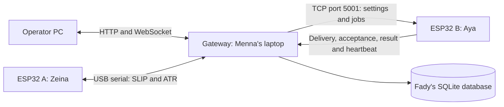
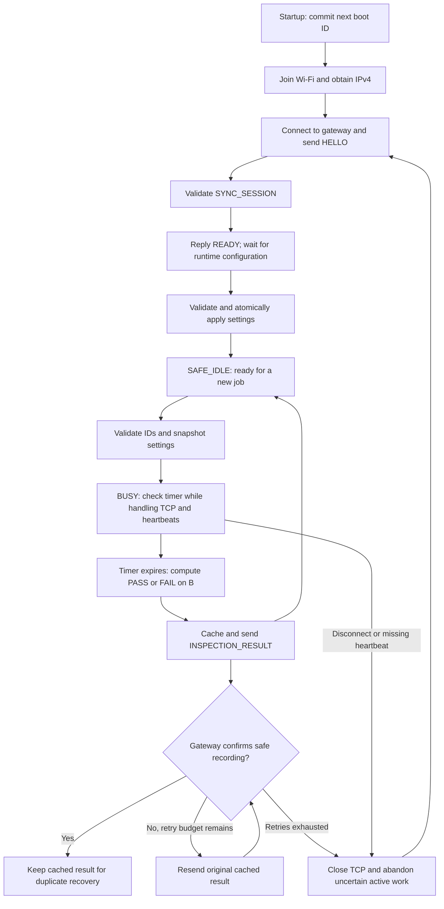

# Station B in the team network

Only the inspection station's application is implemented in this project. The PC tools
are test peers. They do not replace the team's production gateway or operator dashboard.

# Connection and execution flow

The boxes below describe internal processing stages, not extra global operating states.
The gateway still owns exactly IDLE, RUNNING, PAUSED and FAULT.

The gateway must abort the interrupted batch before allowing fresh work in a new session.
After reconnecting, B starts with no active job and no applied runtime configuration.
An identical duplicate in the same session returns status or its cached result; it does
not follow the new-job timer path again.
